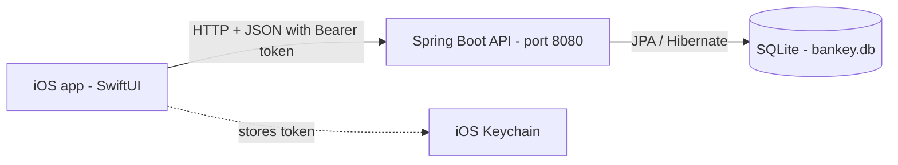
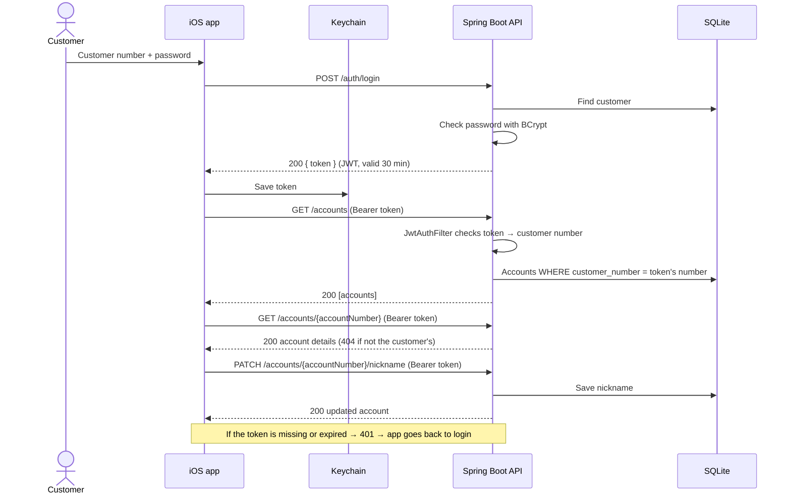

# Bankey – Bank App

A native iOS app (SwiftUI) where customers log in, view their accounts, view account details and set an account nickname.
The backend is a Spring Boot REST API with an SQLite database. Access is protected with JWT authentication.

## How the app communicates





## Tech stack

| Part | Technology |
|---|---|
| iOS app | Swift, SwiftUI, MVVM, async/await, URLSession, Keychain |
| Backend | Java 21, Spring Boot 4, Spring Security, Spring Data JPA, JJWT |
| Database | SQLite (file `bankey.db`) |

## Data

| Field | Type | Rule |
|---|---|---|
| Customer Number | Int | 9 digits, unique per customer |
| Account Number | String | 9 characters, unique globally |
| Balance | Float | |
| Nickname | String | up to 255 characters, optional |

## API

| Method | Path | Auth | Description |
|---|---|---|---|
| POST | `/auth/login` | No | Log in, returns a JWT |
| GET | `/accounts` | Yes | The logged-in customer's accounts |
| GET | `/accounts/{accountNumber}` | Yes | One account's details |
| PATCH | `/accounts/{accountNumber}/nickname` | Yes | Set or clear the nickname |

## Security

- Passwords are stored only as **BCrypt** hashes.
- After login the server returns a **JWT** (expires after 30 minutes). The app stores it in the **Keychain** and sends it as `Authorization: Bearer <token>`.
- The customer number always comes from the **token**, never from the app. Every account query also filters by that customer number, so a customer can never see another customer's account (returns 404).
- Wrong customer number and wrong password return the **same** error message.
- The JWT secret is read from an environment variable (`.env`) and is **not** committed to GitHub.
- The API is stateless (no server sessions).

## How to run

### Requirements
- Java 21
- Xcode (iOS 17 or newer simulator)

### 1. Backend
1. Copy `.env.example` to `.env` and set `JWT_SECRET` to a random text of at least 32 characters.
2. Start the server:
   - **VS Code:** Run and Debug → **Bankey Backend** → ▶️
   - **or Terminal:**
     ```bash
     cd backend
     export $(cat ../.env | xargs)
     ./mvnw spring-boot:run
     ```
3. The API runs on `http://localhost:8080`. On first start, test data is created automatically.

### 2. iOS app
1. Open `ios/Bankey/Bankey.xcodeproj` in Xcode.
2. Choose an iPhone simulator and press **Run** (Cmd+R).

> To run on a real iPhone, change `baseURL` in `APIClient.swift` to your Mac's Wi-Fi IP address (for example `http://192.168.1.20:8080`). The phone and the Mac must be on the same network.

## Test logins

| Customer number | Password | Accounts |
|---|---|---|
| `123456789` | `Password123` | 100000001 (Salary), 100000002 |
| `987654321` | `Secret456` | 200000001 (Savings) |

## Project structure

```
Bankey/
├── backend/                 Spring Boot API
│   └── src/main/java/com/bankey/backend/
│       ├── controller/      REST endpoints
│       ├── service/         Business rules
│       ├── repository/      Database access
│       ├── model/           Customer, Account
│       ├── dto/             Request / response objects
│       ├── security/        JWT + Spring Security
│       └── config/          Test data seeder
└── ios/Bankey/Bankey/       SwiftUI app
    ├── Models/              Account, login models
    ├── Services/            APIClient, KeychainHelper
    ├── ViewModels/          Auth, Accounts, AccountDetail
    └── Views/               Login, AccountsList, AccountDetail
```
