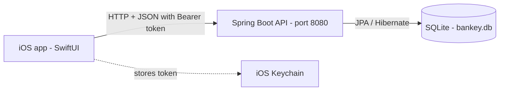

# Bankey – Bank App

An iPhone app where customers log in, see their accounts, open an account and give it a nickname.

- **iOS app:** Swift + SwiftUI
- **Backend:** Spring Boot (Java 21)
- **Database:** SQLite
- **Login:** JWT token

## How it works

1. The customer logs in. The server checks the password and sends back a token.
2. The app saves the token in the Keychain and sends it with every request.
3. The server only returns accounts that belong to the customer in the token.

## API

| Method | Path | What it does |
|---|---|---|
| POST | `/auth/login` | Log in and get a token |
| GET | `/accounts` | My accounts |
| GET | `/accounts/{accountNumber}` | One account |
| PATCH | `/accounts/{accountNumber}/nickname` | Change the nickname |

## How to run

**Backend**
1. Copy `.env.example` to `.env` and set `JWT_SECRET` (at least 32 characters).
2. In VS Code: Run and Debug → **Bankey Backend** → ▶️

**iOS app**
1. Open `ios/Bankey/Bankey.xcodeproj` in Xcode.
2. Pick a simulator and press **Run**.

## Test logins

| Customer number | Password |
|---|---|
| `123456789` | `Password123` |
| `987654321` | `Secret456` |
